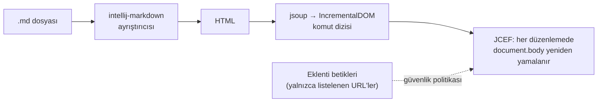
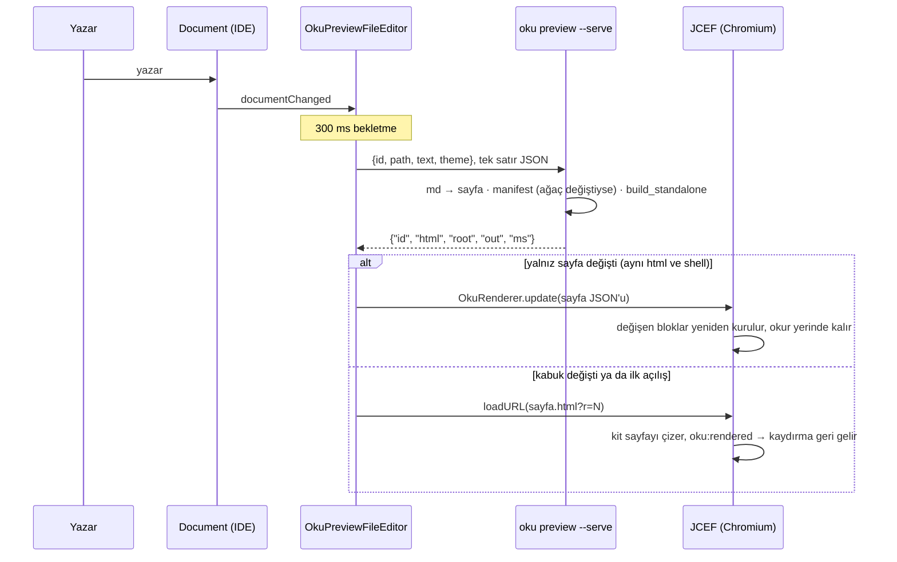
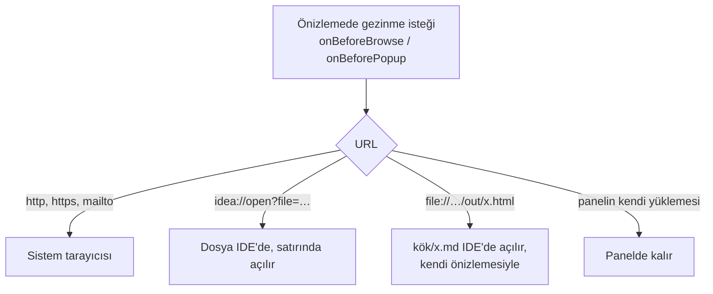
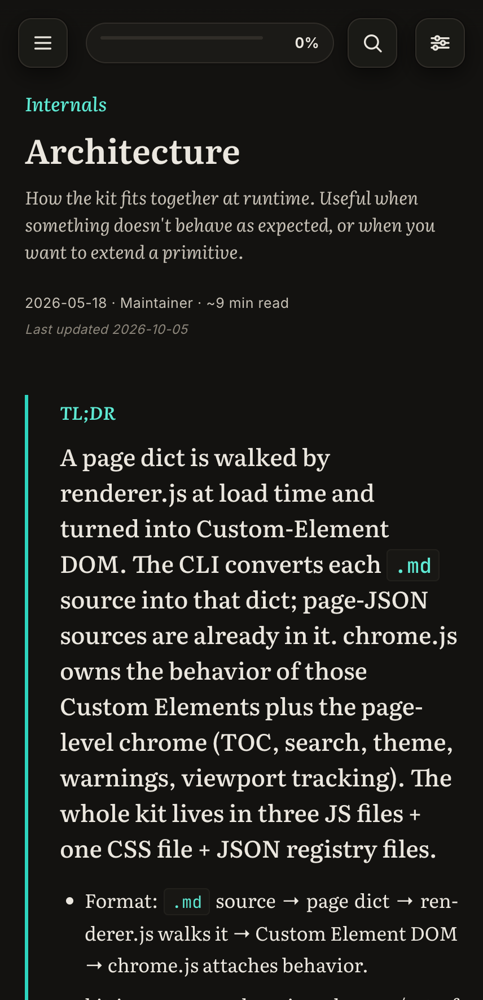

> [!TLDR]
> Doğru yol IDEA'nın Markdown önizlemesine eklenti yazmak değil, **oku sayfaları için kendi düzenleyicimizi açmak**: solda IDE'nin metin düzenleyicisi, sağda gömülü Chromium'da kitin kendi çalışma zamanı. PoC bunu IDEA 2026.2.3 üzerinde çalıştırdı.
>
> - Önizleme `oku build`'in ürettiği sayfanın aynısı: aynı dönüştürücü, aynı `build_standalone`, aynı chrome.js. IDE içinde sayılan bölüm, diyagram, kod satırı ve içindekiler bağlantısı, başsız Chromium'dakilerle birebir aynı çıktı.
> - Diskteki bir değişiklik, IDE'nin eşitlemesi dahil 0,88–0,91 saniyede önizlemeye düşüyor ve okuma konumu korunuyor. Sayfa bağlantısı ile "editörde aç" bağlantısı dosyayı IDE'de açıyor.
> - Planın 1. aşaması bitti: eklenti oku'nun iç fonksiyonlarına değil, belgelenmiş `oku preview --serve` komutuna bağlı. IDE'nin tamamı tek bir süreçle konuşuyor; bir düzenlemenin dönüştürme maliyeti sayfaya göre 189–314 ms'den 22–135 ms'ye indi.
> - 2. aşama da bitti: bir düzenleme sayfayı yeniden yüklemiyor. Kit yalnızca düzenlemenin değiştirdiği blokları yeniden kuruyor; açık ayrıntılar, tablo süzgeçleri ve çizilmiş diyagramlar yerinde kalıyor, okur baktığı yerde kalıyor.
> - 3. aşama da bitti: önizlemedeki bir dosya çipi ya da yerel bir `.md` bağlantısı dosyayı IDE'de, başvurunun andığı satırda açıyor; macOS'a bağlı `idea://` bağlantısı yerine kitin `window.__okuHost` kancasıyla, her işletim sisteminde.
> - 4. aşama da bitti: önizleme düzenleyiciyi izliyor. Düzenleyicinin tepesindeki kaynak satırı sayfanın tepesine geliyor; sayfada bir çift tıklama imleci o satıra götürüyor ve hiçbir bölme yerinden sıçramıyor.
> - 5. aşama da bitti: düzenleyici yazarken yardım ediyor. Bir `oku-chart` bloğunun gövdesi JSON olarak tanınıyor ve anahtarları oku'nun şemasından tamamlanıyor; `oku check`'in bulguları kaydetmeden, ilgili satırda görünüyor; bir `#f/` bağlantısı dosya başvurusu olarak tamamlanıyor ve dosyaya gidiyor.
> - Sırada: sağlamlaştırma ve dağıtım.

Bu belge bir **öğretici** sırayla ilerliyor: her bölüm bir önceki sorunun bıraktığı soruyu cevaplıyor. Önce IDEA'nın bugün ne yaptığı, sonra iki çözüm yolu ve neden birinin seçildiği, sonra PoC'nin gösterdikleri ve en sonda plan ile senin vermen gereken kararlar.

## IDEA bir oku sayfasını bugün nasıl gösteriyor? {#bugun}

IDEA'nın gömülü Markdown eklentisi bir `.md` dosyasını kendi ayrıştırıcısıyla (intellij-markdown) HTML'e çeviriyor, sonra bu HTML'i her düzenlemede gömülü Chromium'daki (JCEF) sayfanın `<body>`'sine yamayarak gösteriyor. oku'nun ayrıştırıcısı, tipli blokları ve sayfa çerçevesi bu hattın hiçbir yerinde yok. Bu yüzden sayfa "dümdüz Markdown" gibi görünüyor.



*Gömülü önizlemenin hattı. Kaynak: [MarkdownJCEFHtmlPanel.kt](https://github.com/JetBrains/intellij-community/blob/cf6ba6dbed8ca02ca1bdd5abfe22c45b3f885519/plugins/markdown/jcef/src/com/intellij/markdown/jcef/preview/MarkdownJCEFHtmlPanel.kt) satır 262: `IncrementalDOM.patch(document.body, …)`.*

Bir oku sayfasının parçaları bu hattan şöyle geçiyor:

```oku-table
{"headers":["oku öğesi","Gömülü önizlemede","Kanıt"],"rows":[["YAML front-matter","Gizli (2026.2); bir kayıt anahtarıyla ham `<pre>`. 2026.3 dalında tablo olarak çiziliyor","kaynakta okundu"],["` ```oku-chart ` ve diğer tipli bloklar","Bilinmeyen dilde düz kod bloğu","kaynaktan çıkarım"],["`> [!TLDR]`","Düz alıntı bloğu: 2026.2 yalnızca NOTE, TIP, IMPORTANT, WARNING, CAUTION tanıyor","kaynakta okundu"],["`mermaid`","JetBrains'in Mermaid eklentisi kuruluysa çiziliyor","eklenti jar'ında okundu"],["İçindekiler, ilerleme rayı, menü, arama, sözlük ipuçları","Yok","—"],["`#f/` dosya çipleri, `#g/` sözlük bağlantıları","Sayfa içi ölü bağlantı","kaynaktan çıkarım"]]}
```

O zaman ilk soru şu: oku bu hattın içine takılabilir mi?

## Neden "mevcut önizlemeye eklenti" yolu tıkanıyor? {#yol-a}

İlk akla gelen yol, oku'yu gömülü önizlemeye bir eklenti olarak takmak. Markdown eklentisinin bunun için uzantı noktaları var: tarayıcıya betik ve stil enjekte eden `browserPreviewExtensionProvider`, belirli bir dildeki kod bloğunu HTML'e çeviren `fenceGeneratingProvider` ve ayrıştırmayı değiştiren `flavourProvider`. JetBrains'in Mermaid eklentisi tam da bu yolu kullanıyor. Ancak oku'nun ihtiyacına üç yerden takılıyor:

```oku-compare-grid
{"cards":[{"t":"A · Gömülü önizlemeye eklenti","b":"Tipli blokları `fenceGeneratingProvider` ile çizip kitin betiklerini `browserPreviewExtensionProvider` ile enjekte etmek.\n\n- IDE her düzenlemede `document.body`'yi yeniden yamalıyor; kitin eklediği kenar çubuğu, ray ve kendi içeriğini çizen her öğe bir sonraki yamada siliniyor *(incremental-dom davranışından çıkarım, denenmedi)*.\n- Güvenlik politikası satır içi betiğe ve `fetch`'e kapalı (`connect-src 'none'`); kit `kit.json`'u, sözlüğü ve manifesti okuyamıyor.\n- Blok uzantı noktası `@Internal` ve `@Obsolete`; çıktısı `<pre><code>` içine sarılıyor.","verdict":"bad"},{"t":"B · Kendi düzenleyicimiz","b":"oku sayfaları için ayrı bir düzenleyici: solda platformun metin düzenleyicisi, sağda bizim yönettiğimiz bir JCEF tarayıcısı. İçinde kitin kendisi çalışıyor.\n\n- Çizim `oku build` ile aynı, çünkü aynı kod çalışıyor.\n- Güvenlik politikası ve güncelleme modeli bizim.\n- Kullanılan API'ler herkese açık: `FileEditorProvider`, `TextEditorWithPreview`, `JBCefBrowser`.\n- Bedeli: dönüştürücü Python'da, makinede oku kurulu olmalı.","verdict":"good"},{"t":"C · B + A'nın küçük bir parçası","b":"oku ağacındaki sayfalar B ile açılır. oku ağacı dışındaki sıradan bir `.md` dosyası yalnızca bir `oku-chart` içeriyorsa, o blok gömülü önizlemede A'nın blok uzantısıyla çizilir.\n\nSonraya bırakılabilecek bir ek: çekirdek ihtiyaç B ile karşılanıyor, A'nın kırılgan API'si yalnızca bu dar durum için devreye girer.","verdict":"neutral"}]}
```

Karşılaştırmanın hangi eksende yapıldığı sonucu değiştiriyor. Bu yüzden eksenler ayrı ayrı:

```oku-table
{"headers":["Eksen","A · Gömülü önizlemeye eklenti","B · Kendi düzenleyicimiz"],"rows":[["Çizimin `oku build` ile aynı olması","Kısmi: ayrıştırıcı intellij-markdown, kitin çerçevesi yok","Aynı: PoC'de IDE içi sayılar başsız Chromium'la birebir"],["Canlı güncelleme","IDE body'yi yamalıyor; kit DOM'u kalıcı değil *(çıkarım)*","Bizim elimizde: bugün yeniden yükleme, sonra yerinde güncelleme"],["Güvenlik politikası","Satır içi betik yok, `fetch` yok","Kendi politikamız"],["API kararlılığı","Blok uzantısı `@Internal`, `@Obsolete`","Herkese açık platform API'leri"],["Kurulum bağımlılığı","Yalnızca eklenti (kit JS'i içine paketlenir)","Makinede kurulu oku (Python) — **B'nin zayıf ekseni**"],["Gömülü önizleme","Aynı panel","oku sayfalarında gizlenir, diğer `.md` dosyaları etkilenmez"]]}
```

**Kurulum bağımlılığı ekseninde sıralama tersine dönüyor.** oku kurulu olmayan biri için A, ya da dönüştürücüsü JavaScript'e taşınmış bir B tek seçenek. Senin makinende oku kurulu ve eklentiyi önce sen kullanacaksın; bu yüzden aşağıdaki öneri B. Eklenti başkalarına dağıtılacaksa bu karar yeniden açılmalı ([kararlar](#kararlar)).

Kaynaklar, hepsi intellij-community `cf6ba6d` (2026-10-06) üzerinde okundu: [Markdown eklentisinin plugin.xml'i](https://github.com/JetBrains/intellij-community/blob/cf6ba6dbed8ca02ca1bdd5abfe22c45b3f885519/plugins/markdown/core/resources/META-INF/plugin.xml), [PreviewStaticServer.kt](https://github.com/JetBrains/intellij-community/blob/cf6ba6dbed8ca02ca1bdd5abfe22c45b3f885519/plugins/markdown/core/src/org/intellij/plugins/markdown/ui/preview/PreviewStaticServer.kt) (`createCSP`, satır 93-97), [CodeFenceGeneratingProvider.kt](https://github.com/JetBrains/intellij-community/blob/cf6ba6dbed8ca02ca1bdd5abfe22c45b3f885519/plugins/markdown/core/src/org/intellij/plugins/markdown/extensions/CodeFenceGeneratingProvider.kt), [MarkdownAlertTitle.kt](https://github.com/JetBrains/intellij-community/blob/cf6ba6dbed8ca02ca1bdd5abfe22c45b3f885519/plugins/markdown/core/src/org/intellij/plugins/markdown/lang/psi/impl/MarkdownAlertTitle.kt). Mermaid eklentisinin kaynağı kapalı; davranışı eklenti jar'ındaki `mermaid-withMarkdown.xml`'den okundu.

## Önerilen yol nasıl çalışıyor? {#mimari}

Eklenti bir oku sayfasını açtığında IDE'nin kendi metin düzenleyicisini ve bir önizleme panelini yan yana koyuyor. Panel, sayfayı kendi çizmiyor: düzenleyicideki metni (kaydedilmemiş olsa bile) kurulu oku'nun `oku preview --serve` sürecine veriyor, oku `oku build`'in tek bir sayfa için yaptığı işi yapıyor ve panel çıkan sayfayı gösteriyor. Süreç IDE'nin tamamı için bir tane: açık her önizleme onu paylaşıyor, Python yalnızca bir kez başlıyor ve ağaç değişmedikçe site manifesti yeniden hesaplanmıyor.



*Bir düzenlemenin yolculuğu. HTML, projede değil IDE'nin sistem dizininde (`system/oku-preview/`) duruyor; Chromium'a taşıma aracı, kullanıcının gördüğü ya da işlediği bir dosya değil.*

Panelden çıkmak isteyen her gezinme isteği yakalanıyor ve IDE'ye devrediliyor. Böylece önizleme hiçbir zaman başka bir sayfaya "kaymıyor":



PoC'nin parçaları aşağıda. Bu düzenek gerçekten build'in çizimini veriyor mu, ve ne kadar hızlı? Sonraki bölüm ölçümleri gösteriyor.

```oku-table
{"headers":["Dosya","Ne yapıyor"],"rows":[["[OkuPreviewEditorProvider.kt](#f/ide/intellij/src/main/kotlin/io/github/mmdemirbas/oku/OkuPreviewEditorProvider.kt)","Hangi dosyaları alacağına karar verir ve metin + önizleme düzenleyicisini kurar. `HIDE_OTHER_EDITORS` yalnızca kabul edilen dosyada Markdown'ın kendi önizlemesini gizler."],["[OkuPages.kt](#f/ide/intellij/src/main/kotlin/io/github/mmdemirbas/oku/OkuPages.kt)","Bir `.md` dosyası oku sayfası mı: üst dizinlerde `kit.json` ya da `_oku` (`.git`'e kadar) varsa veya dosyada ` ```oku- ` bloğu geçiyorsa. Front-matter tek başına işaret değil; Jekyll ve Hugo sayfalarında da var."],["[OkuPreviewFileEditor.kt](#f/ide/intellij/src/main/kotlin/io/github/mmdemirbas/oku/OkuPreviewFileEditor.kt)","JCEF paneli, 300 ms bekletmeli yeniden çizim, IDE temasına uyum ve bağlantıların IDE'ye devri. Başarısız bir çizim, sekme yeniden seçilince tekrar deneniyor."],["[OkuPreviewService.kt](#f/ide/intellij/src/main/kotlin/io/github/mmdemirbas/oku/OkuPreviewService.kt)","IDE'nin tamamı için tek `oku preview --serve` süreci. Süreç önce protokol numarasını söylüyor; eklentininkinden farklıysa panel hangi tarafın güncelleneceğini yazıyor. Süreç ölür ya da 30 saniye içinde yanıt vermezse bir sonraki çizimde yenisi başlıyor. `oku` PATH'te, bulunamazsa `~/.local/bin`'de aranıyor, çünkü Dock'tan açılan IDE'de kabuğun PATH'i yok; `-Doku.executable` bir checkout'u gösteriyor."],["`oku preview` ([cli.md](#f/docs/cli.md))","Sözleşmenin oku tarafı: tek sayfayı `oku build`'in yazdığı gibi yazar, yanıtı tek satır JSON'dur. `--serve` istekleri satır satır alır ve ağacın manifestini ağaç değişene kadar önbellekte tutar. [test_preview.py](#f/src/oku_tests/test_preview.py) önizlenen sayfayı build'in sayfasıyla karşılaştırıyor."],["[plugin.xml](#f/ide/intellij/src/main/resources/META-INF/plugin.xml)","`com.intellij.modules.platform` ve `com.intellij.modules.jcef` bağımlılıkları, tek uzantı: `fileEditorProvider`."]]}
```

## PoC ne gösterdi? {#poc}

### IDE içindeki çizim, build'in çizimiyle aynı mı?

Aynı. IDE'nin gömülü Chromium'u uzaktan hata ayıklama portuyla (9222) açıldı ve sayfa, repodaki tarayıcı testlerinin yaptığı gibi CDP üzerinden sayıldı. Aynı sayfanın başsız Chromium'daki sayılarıyla karşılaştırma:

```oku-table
{"headers":["docs/index.md","Başsız Chromium","IDE içi (JCEF, 428 × 885)"],"rows":[["Bölüm","4","4"],["Mermaid diyagramı (SVG)","1 (5)","1 (5)"],["Kod satırı","28","28"],["İçindekiler bağlantısı","6","6"],["Site ağacı satırı","16","16"],["Tema","koyu (istenen)","koyu (IDE koyu temada)"],["Konsol hatası / başarısız istek","0 / 0","ölçülmedi"]]}
```

Başsız Chromium'da daha ağır iki sayfa da tarandı: `reference.md` 41 tablo, 268 kod satırı, 5 dosya çipi; `charts.md` 92 grafik. Hiçbirinde konsol hatası ya da başarısız istek yok. Mermaid ve Prism, ağ olmadan kitin kendi kopyasından yüklendi.



*IDE içindeki önizleme, CDP ekran görüntüsü. Panel bölünmüş düzenleyicinin yarısı olduğu için kit telefon düzenine geçmiş.*

### Bir düzenleme ne kadar sürede görünüyor?

PoC'de her düzenleme kurulu oku'yu yeni bir süreç olarak başlatıyordu: bir çalıştırma sayfaya göre 0,19–0,31 saniye sürüyor ve bunun yaklaşık 90 ms'si yalnızca Python'un başlaması, 49 ms'si site manifesti. Eklenti artık tek bir `oku preview --serve` süreciyle konuşuyor; aynı sayfalar iki yolda da ölçüldü. Sayılar [measure_render.py](#f/ide/intellij/tools/measure_render.py) ile üretildi; grafiğin verisi onun çıktısı:

```oku-chart
{"type":"stacked-bar","title":"Bir yeniden çizimin dönüştürme maliyeti, ms (sıcak, 5 koşunun ortancası)","categories":["index.md (7 KB) · süreç başına","index.md (7 KB) · --serve","charts.md (75 KB) · süreç başına","charts.md (75 KB) · --serve","reference.md (49 KB) · süreç başına","reference.md (49 KB) · --serve"],"series":[{"label":"Python başlangıcı, içe aktarma, G/Ç","values":[88,0,88,1,89,1]},{"label":"md → sayfa sözlüğü","values":[33,3,35,5,38,5]},{"label":"site manifesti","values":[49,0,49,0,49,0]},{"label":"standalone HTML","values":[19,19,24,23,138,129]}]}
```

*Süreç başına çalıştırmada Python'un başlaması her sayfada yaklaşık 90 ms, manifest 49 ms. `--serve`'de ikisi de 0–1 ms: süreç bir kez başlıyor ve ağaçta bir dosya değişmedikçe manifesti yeniden hesaplamıyor. Kalan maliyet standalone HTML: reference.md'de 129–138 ms, çünkü sayfanın `#f/` ile andığı dosyaların baytları sayfanın içine taşınıyor (çıktı 3,4 MB). 73 sayfalık bir ağaçta manifestin ilk hesaplanması ölçülmedi.*

Uçtan uca süre IDE içinde ölçüldü. Bir sayfa diske yazıldı ve IDE'nin penceresi etkinleştirildi, çünkü IDE dışarıdan gelen değişikliği ancak pencere etkinleşince ya da yeni bir sekme açılınca okuyor. Bu süre IDE'nin eşitlemesini, 300 ms bekletmeyi, dönüştürmeyi ve sayfanın yeniden yüklenmesini içeriyor: `--serve` ile üç koşuda **0,88–0,91 saniye**; PoC'nin süreç başına yolunda 1,00–1,05 saniye, geri almada 0,98–1,01 saniyeydi. Dönüştürmedeki yaklaşık 170 ms'lik kazancın uçtan uca yansıması 0,1–0,15 saniye, çünkü kalan süreyi eşitleme, bekletme ve yeniden yükleme alıyor. Geri alma `--serve` ile geçerli biçimde ölçülemedi: o koşularda IDE etkinleşmedi (aşağıdaki tuzaklara bakın). Klavyeden yazmada eşitleme adımı yok, metin doğrudan Document'a giriyor. O yolun süresi ayrıca ölçülmedi.

### Neler denendi, neler denenmedi?

```oku-table
{"headers":["Davranış","Sonuç","Nasıl"],"rows":[["Sayfa IDE'de kitin çizimiyle açılır","index: tablodaki sayılar · architecture: 12 bölüm, 6 diyagram (30 SVG), 38 kod satırı","[probe_ide.py](#f/ide/intellij/tools/probe_ide.py)"],["Ön sekmedeki değişiklik önizlemeye düşer","yerinde güncellemeyle 0,88–1,47 sn, 3 koşu; tam yeniden yüklemeyle 0,88–0,91 sn, PoC'de 1,00–1,05 sn","[edit_sync_ide.py](#f/ide/intellij/tools/edit_sync_ide.py)"],["Arka sekmedeki önizleme de güncellenir","ön sekmeyle aynı anda","edit_sync_ide.py, iki dosyayla"],["Düzenleme sayfayı yeniden yüklemez","3/3 koşuda ön ve arka sekmede aynı belge kaldı; architecture.md'nin 18 diyagram öğesi düzenlemeden sonra aynı düğüm, 38 SVG yerinde","edit_sync_ide.py (`reloaded`)"],["Okur yerinde kalır, üstte metin büyüse de","üç uzun paragraf eklendi: başlık ekranda −120,3 → −120,6 px (1100 px), −120,4 → −120,3 px (360 px)","[test_update_in_place.py](#f/src/oku_tests/browser/test_update_in_place.py)"],["Okuma konumu korunur","600 px → 598,5–600 px","[nav_and_edit_ide.py](#f/ide/intellij/tools/nav_and_edit_ide.py)"],["Sayfa bağlantısı IDE'de açılır, panel yerinde kalır","IDE günlüğü: `fileOpened reference.md`","nav_and_edit_ide.py"],["`idea://` \"editörde aç\" bağlantısı","IDE günlüğü: `fileOpened glossary.md`, panel yerinde","[idea_link_ide.py](#f/ide/intellij/tools/idea_link_ide.py)"],["Dosya çipi IDE'de, satırında açılır","reference.md'deki `starter.md:3` çipi: panelde görüntüleyici açılmadı; IDE günlüğü `the page opens …/starter.md line 3`, `fileOpened starter.md`","CDP ile tıklama; kit tarafı [test_host_hook.py](#f/src/oku_tests/browser/test_host_hook.py)"],["Tema IDE'yi izler","koyu IDE → `data-theme=dark`","probe_ide.py"],["Yeniden yükleme sonrası kaydırma","2400 → 2400 px, 120 ms içinde","[check_preview.py](#f/ide/intellij/tools/check_preview.py)"],["Önizleme `oku build`'in sayfasıyla aynı","`__oku_page__` birebir aynı","[test_preview.py](#f/src/oku_tests/test_preview.py)"],["Eski bir oku kuruluysa panel ne yapılacağını söyler","\"the installed oku has no `preview` command: update it (./ctl deploy in the oku repository)\", iki sekmede de","[retry_ide.py](#f/ide/intellij/tools/retry_ide.py), [broken_oku.sh](#f/ide/intellij/tools/broken_oku.sh) ile"],["oku düzelince önizleme IDE yeniden başlatılmadan geri gelir","düzenlenen sekme bir sonraki çizimde; hiç dokunulmayan sekme seçilince, 0,21 sn","retry_ide.py"],["Önizleme düzenleyiciyi izler","Page Down / Page Up'tan 1 sn sonra sayfanın tepesindeki satır ile düzenleyicininki: 6 basışın 5'inde en fazla 0,01 satır fark; birinde 13 satır (açıklanamadı, aşağıda)","[follow_ide.py](#f/ide/intellij/tools/follow_ide.py)"],["Sayfada çift tıklama düzenleyiciyi o satıra götürür","imleç 128. satırda; düzenleyicinin tepesi 126,545, sayfanınki 126,555; sayfa yerinden oynamadı (y 10743 → 10743)","follow_ide.py, idea.log"],["Bir bloğun gövdesi JSON'dur, anahtarları şemadan tamamlanır","`oku-table` gövdesi JSON dili; `oku-chart` içinde `rows` ve `title` öneriliyor, bir tablonun `headers`'ı önerilmiyor; şema sağlayıcısı çıkarılınca test düşüyor","[OkuFencesTest.kt](#f/ide/intellij/src/test/kotlin/io/github/mmdemirbas/oku/OkuFencesTest.kt)"],["Blok etiketi tamamlanır","`oku-ta` → `oku-table`","OkuFencesTest.kt"],["`oku check`'in bulguları düzenleyicide, satırında görünür","başka sayfada olmayan çapa 8. satırda uyarı; `rows: 3` 10. satırda, alanın adıyla hata; satır bir kaydırılınca test düşüyor","[OkuCheckAnnotatorTest.kt](#f/ide/intellij/src/test/kotlin/io/github/mmdemirbas/oku/OkuCheckAnnotatorTest.kt)"],["Kaydedilmemiş metin denetlenir, diskteki dosya değil","yalnızca tampona eklenen bağlantının bulgusu kendi satırında; diskten okununca test düşüyor. reference.md'de bir denetim 230–320 ms, yük ortalaması ~350 iken","OkuCheckAnnotatorTest.kt; kit tarafı [test_preview.py](#f/src/oku_tests/test_preview.py)"],["`#f/` bağlantısı dosyaya gider ve tamamlanır","`#f/src/x.py`, `#f/../src/x.py` ve `#f/src/x.py:2` aynı dosyaya; `#f/sr` → `src`; taban yalnızca sayfanın dizini olunca test düşüyor","[OkuReferencesTest.kt](#f/ide/intellij/src/test/kotlin/io/github/mmdemirbas/oku/OkuReferencesTest.kt)"],["oku bağlantıları \"çapa bulunamadı\" sayılmaz","Markdown'ın denetimi `#g/term`, `#x/ref` ve `#nowhere`'i bildiriyor; eklentiyle yalnızca `#nowhere`","OkuReferencesTest.kt"],["oku sayfası olmayan Markdown'a dokunulmaz","kit.json'u olmayan bir README'de ne bulgu ne `#f/` başvurusu","OkuCheckAnnotatorTest.kt, OkuReferencesTest.kt"]]}
```

Denenmeyenler, ve neden:

- **İzlemedeki 13 satırlık sapma.** Sandbox'ın ilk koşusunda, yük ortalaması 350 civarındayken, ikinci Page Down'dan sonra sayfa 204. satır yerine 217,25'te duruyordu ve basışlar düzensiz ilerledi (aşağı 37,5 / 40 / 40 / 88,5, yukarı 82,5 / 0 satır). Aynı betik başsız Chromium'da yeniden oynatıldığında beş hedefin hepsi 0,03 satır içinde kaldı ve 3 saniye boyunca kaymadı. İkinci sandbox koşusunda tuşlar IDE'ye ulaşmadı ve nedeni belirlenmedi; ölçüm tekrarlanmadı.
- **Şemaya uymayan bir anahtarın blok içinde altının çizilmesi.** JSON eklentisinin şema uyumluluk denetimi, enjekte edilmiş blokta `showProblemsInCodeBlocks` açıkken bile işaret koymadı; nedeni bulunamadı. Aynı hata, alanın yoluyla birlikte `oku check` bulgusu olarak satırında görünüyor.
- **5. aşamanın sandbox'ta, ekranda görülmesi.** Sen makinede çalışırken sandbox'ı öne almak odağını çalacaktı. Davranışlar platformun test düzeneğinde, gerçek dosyalarla ve gerçek bir `oku preview --serve` süreciyle doğrulandı; ekran görüntüsü yok.
- **Büyük bir ağaçta denetimin süresi.** 230–320 ms bu reponun belgelerinde ölçüldü; 73 sayfalık bir ağaç denenmedi.
- **Klavyeden yazarken gecikme.** Kod yolu aynı (`documentChanged`), ama süre disk değişikliği ve pencere etkinleştirmesiyle ölçüldü.
- **Dış bağlantının sistem tarayıcısında açılması.** Senin tarayıcında bir sekme açacağı için tetiklenmedi.
- **`idea://` ile açılan dosyada imlecin 20. satırda olması.** Dosyanın açıldığı görüldü, imlecin satırı okunmadı.
- **IDE teması çalışırken değişince önizlemenin uyması.** Kod `LafManagerListener` ile yeniden çiziyor, tetiklenmedi.
- **Windows, Linux ve diğer IntelliJ tabanlı IDE'ler.** Eklenti yalnızca platforma ve JCEF'e bağlı; çalışması beklenir, denenmedi.
- **Metin tarafında Markdown özellikleri** (vurgulama, yapı görünümü). Sol taraf platformun Markdown dosya türündeki normal düzenleyicisi, `HIDE_OTHER_EDITORS` yalnızca Markdown'ın bölünmüş düzenleyicisini gizliyor. Özelliklerin sürmesi beklenir, ekran görüntüsüyle doğrulanmadı.

Bu sonuçlara giden yolda düzeltilmesi gereken on bir şey çıktı.

## Yolda hangi tuzaklar çıktı? {#tuzaklar}

Her birinin sonraki aşamalara taşınacak bir dersi var. İlk altısı eklentide düzeltildi; son beşi test düzeneğini etkiledi.

```oku-timeline
{"events":[{"status":"done","label":"derleme","t":"IDEA 2026.2, Kotlin 2.4 ile derlenmiş","b":"Platformun Kotlin standart kütüphanesi 2.4.0 metadata'sı taşıyor; Kotlin 2.2 derleyicisi en fazla 2.3'ü okuyabildiği için `Regex` bile çözülemedi. Eklenti Kotlin 2.4.20 ile derleniyor."},{"status":"done","label":"derleme","t":"JCEF artık ayrı bir gömülü eklenti","b":"`com.intellij.ui.jcef` platform çekirdeğinde değil, `com.intellij.modules.jcef` eklentisinde. Gradle'da `bundledPlugin`, plugin.xml'de `depends` gerekiyor."},{"status":"done","label":"kaydırma","t":"Kit `<html>` üzerinde `scroll-behavior: smooth` kullanıyor","b":"Yeniden yüklemeden sonra düz bir `scrollTo`, sayfayı her düzenlemede tepeden aşağı kaydırarak canlandırıyordu (300 ms'de 2400 yerine 1938 px). Geri yükleme artık `behavior: 'instant'`."},{"status":"done","label":"güncelleme","t":"JBCef aynı URL'yi ikinci kez yüklemiyor","b":"`JBCefBrowserBase.loadUrlImpl` en son istenen URL'yi atlıyor: \"URL already requested, skipping\" ([kaynak](https://github.com/JetBrains/intellij-community/blob/cf6ba6dbed8ca02ca1bdd5abfe22c45b3f885519/platform/ui.jcef/jcef/JBCefBrowserBase.java#L668-L683)). İlk sürümde her yeniden çizim yapılıyor ama panele hiç ulaşmıyordu. Her çizime bir `?r=N` sorgusu ekleniyor ([OkuPreviewFileEditor.kt](#f/ide/intellij/src/main/kotlin/io/github/mmdemirbas/oku/OkuPreviewFileEditor.kt), `render()`)."},{"status":"done","label":"eklenti","t":"Vurgulama sürerken hiçbir dosya değişemez","b":"Bloğun şemasını diske yazıp VFS'yi yenilemek, ardından JSON şema önbelleğini sıfırlamak IDE'nin \"PSI/document/model changes are not allowed during highlighting\" kuralına takıldı: oku süreci ilk kez bir denetim için, yani vurgulama sırasında başlıyor. Şemalar artık bellekteki `LightVirtualFile`'lar; sıfırlama ve yeniden vurgulama `invokeLater` ile vurgulamanın dışında yapılıyor ([OkuFences.kt](#f/ide/intellij/src/main/kotlin/io/github/mmdemirbas/oku/OkuFences.kt))."},{"status":"done","label":"eklenti","t":"Markdown eklentisi oku bağlantılarını bulunamayan başlık sayıyor","b":"`UnresolvedHeaderReferenceInspection` her `#g/`, `#x/` ve `#f/` bağlantısını \"Cannot resolve anchor\" diye işaretliyordu. Bir `InspectionSuppressor` oku'nun selamlaşmada bildirdiği önekleri susturuyor. Tuzak: `new` ile kurulan bir denetim kendini sınıfının adıyla tanıtıyor, IDE ise kayıttaki `MarkdownUnresolvedHeaderReference` adını kullanıyor; susturucu ikincisine cevap veriyor, test de bu yüzden kayıtlı örneği kullanıyor."},{"status":"note","label":"test","t":"IDE dış değişikliği etkinleşince okuyor","b":"Arka plandaki IDE diske yazılan değişikliği hemen görmüyor, kendi arka plan eşitlemesiyle 10–15 saniye sonra okuyor. Test, pencereyi önce başka bir uygulamaya, sonra IDE'ye vererek eşitlemeyi tetikliyor. Odak zaten IDE'deyse ya da ekran kilitliyse (odak hiçbir yere geçmiyor) etkinleşme olmuyor ve ölçülen süre önizlemeyle ilgili bir şey söylemiyor; betikler artık iki durumu da raporluyor. Yazan bir kullanıcı bu yoldan geçmiyor."},{"status":"note","label":"test","t":"Yeni sekmenin tarayıcısı ancak boyanınca doğuyor","b":"Arka plandaki pencerede açılan bir sekmenin JCEF tarayıcısı CDP'de geç görünüyor. Dosyanın açıldığına bu yüzden IDE günlüğünden (`fileOpened`) bakıldı."},{"status":"note","label":"test","t":"Kit okurken URL'nin hash'ini yazıyor","b":"Kaydırma izleyicisi adresi `index.html#tldr` yapıyor. Testler sayfayı adın sorgu ve hash'ten arındırılmış haliyle buluyor."},{"status":"note","label":"test","t":"Ultimate'ın gizlenmiş bir başlangıç işi platform testlerini düşürüyor","b":"IDEA 2026.2 ile gelen ultimate eklentisinin adı karartılmış (`Z.Z.Z.Z.Z`) bir `postStartupActivity`'si testin hafif projesinde hata veriyor ve her test düşüyordu. Test sandbox'ında `com.intellij.modules.ultimate` kapatılıyor (`prepareTestSandbox`)."},{"status":"note","label":"test","t":"[`bin/oku`](#f/bin/oku) doğrudan çalışınca şema doğrulaması sessizce atlanıyor","b":"[`bin/oku`](#f/bin/oku)'nun shebang'i sistem python3'ü; orada `jsonschema` yok ve oku şema doğrulamasını atlıyor. `oku check` bunu bir satırla söylüyor, önizleme sürecinin denetim yanıtı söylemiyor; şema bulguları bu yüzden boş geliyordu. Testler bu reponun `uv sync` ile kurulan sanal ortamındaki oku'yu kullanıyor."}]}
```

## Bundan sonra ne yapılmalı? {#plan}

Bu tuzaklar PoC'yi çalışır hale getirdi; ürüne giden yol ise aşağıdaki aşamalardan geçiyor. Her aşama tek başına kullanılabilir bir sonuç bırakıyor. İlk üçü oku reposunda bir **sözleşme** kuruyor. Üçü de bitti: eklenti artık oku'nun iç fonksiyonlarına değil `oku preview` komutuna, kitin `OkuRenderer.update`'ine ve `window.__okuHost` kancasına dayanıyor. Sayfadan sayfaya bağlantılar hâlâ gezinmenin yakalanmasıyla IDE'ye gidiyor; o yol çalışıyor ama `#bölüm` çapasını kaybediyor.

```oku-step-flow
{"steps":[{"t":"Kit sözleşmesi: `oku preview` komutu","b":"Yapıldı. `oku preview <sayfa> --out <dizin>` tek sayfayı `oku build`'in yazdığı gibi yazar ve tek satır JSON döndürür; `--stdin` kaydedilmemiş tamponu alır. `--serve` istekleri stdin'den satır satır alır, ilk satırda protokol numarasını ve kit damgasını söyler, ağacın manifestini ağaç değişene kadar önbellekte tutar. Eklenti köprüyü bıraktı ve bu sürece bağlandı; eski bir oku kuruluysa panel `./ctl deploy` gerektiğini söylüyor.","meta":"tamamlandı · cli.py, test_preview.py, cli.md + eklenti"},{"t":"Yeniden yüklemeden güncelleme","b":"Yapıldı. Kitin `OkuRenderer.update(page)`'i yeni sayfayı ekran dışında kurar, işaretlemesi değişmeyen her bloğun canlı düğümünü korur ve okurun baktığı bloğu ekranda aynı yüksekliğe geri koyar; `oku:rendered` yayınlanır, içindekiler ve ray yeniden kurulur. `oku preview` yanıtı HTML'in satır içinde taşıdığı sayfa JSON'unu (`page`) ve HTML'in geri kalanının parmak izini (`shell`) içerir; eklenti `html` ve `shell` panelin tuttuğuyla aynıysa sayfa JSON'unu `executeJavaScript` ile `update`'e verir, değilse yeniden yükler. Bir kaydetme ağacın okura gösterdiği bir şeyi değiştirmedikçe manifest korunur, yani kaydetmek de yeniden yükleme sayılmaz.","meta":"tamamlandı · renderer.js, cli.py, test_update_in_place.py + eklenti"},{"t":"Ana makine kancası","b":"Yapıldı. Kitin `window.__okuHost = { name, openFile(yol, satır) }` kancası: kit, okurun bir dosya açtığı iki yerde — dosya çipi (görüntüleyicideki çipler dahil) ve yerel bir `.md` bağlantısı — önce ona sorar; yalnızca `true` yanıtı işi alır, gerisi kitin görüntüleyicisine düşer. Eklenti kancayı her yüklemenin sonunda sayfaya koyar ve `JBCefJSQuery` ile dosyayı, satırında açar. Bunun için kit, `oku preview` sayfasında tam yolu satır içi manifestin `root_abs` alanından türetmeyi öğrendi; önceden önizlemede tam yol hiç bilinmiyordu. Sayfa bağlantıları için bir `openPage` eklenmedi: gezinmenin yakalanması zaten kaynağı açıyor, kaybolan yalnızca `#bölüm` çapası.","meta":"tamamlandı · chrome.js, test_host_hook.py + eklenti"},{"t":"Düzenleyici ile önizlemeyi eşleme","b":"Yapıldı. `oku preview` sayfaya her bloğun kaynak satırını (`m._lines`) yazar; kit bu satırı çizdiği her bloğa bağlar ve iki yönü sunar: `OkuRenderer.scrollToLine(satır)` bir kaynak satırını pencerenin tepesine koyar, `OkuRenderer.lineAt(y)` bir yükseklikteki satırı söyler. İki blok arasında konum satıra göre ara değerle bulunur, böylece uzun bir blok satırları geçtikçe kayar. Satır işaretlemeye değil DOM'un yanındaki bir haritaya yazılır: işaretlemeye girseydi, yukarıya yazılan bir satır aşağıdaki her bloğun imzasını değiştirir ve `update` bütün sayfayı yeniden kurardı. Eklenti düzenleyicinin görünür alanını dinler ve kare başına en fazla bir kez sayfayı kaydırır; sayfadaki çift tıklama `revealLine` ile gelir, imleç o satıra gider ve düzenleyici sayfanın durduğu yere kaydırılır.","meta":"tamamlandı · renderer.js, chrome.js, cli.py, test_source_lines.py + eklenti"},{"t":"Yazarlık desteği","b":"Yapıldı. Bir oku sayfasında `oku-*` bloğunun gövdesi JSON dili olarak açılır. `oku preview` selamlaşmasında her bloğun şemasını bir dosya olarak bildirir (`page.schema.json`'daki `$defs`'ten, `k` zorunlu olmaktan çıkarılarak) ve eklenti onu JSON eklentisine verir; anahtarlar oradan tamamlanır. Bulgular için aynı süreç protokol 3'te bir `check` isteği alır: kaydedilmemiş tamponu ağacın içinde denetler ve yalnızca o sayfanın bulgularını döndürür; eklenti bunları bir `ExternalAnnotator` ile hata ve uyarı olarak gösterir. Ağacın tamamı denetlendiği hâlde maliyet düşük, çünkü sürenin büyük kısmı olan şema doğrulaması (bu reponun belgelerinde 1,97 saniyenin 1,55'i) yalnızca o sayfada yapılıyor. `#f/` bağlantıları önce sayfanın dizininden, sonra proje kökünden çözülen dosya başvuruları oldu; Markdown eklentisinin bunları bulunamayan başlık saymasını eklenti susturuyor.","meta":"tamamlandı · cli.py, test_preview.py, test_check.py + eklenti, 10 platform testi"},{"t":"Sağlamlaştırma ve dağıtım","b":"oku bulunamazsa Markdown önizlemesine geri düşme ve bildirim. oku yolu için bir ayar sayfası. İçerik okuyan `accept()` yerine `AsyncFileEditorProvider`, `@Obsolete` olan `Alarm` yerine coroutine tabanlı bekletme. Platform testleri ve CDP ile önizleme testleri CI'da, `verifyPlugin`, imzalama, dağıtım kanalı. Python ortamında `jsonschema` yoksa denetim yanıtının bunu söylemesi.","meta":"eklenti"}]}
```

Bu aşamaların bir kısmı, önce verilmesi gereken kararlara bağlı.

## Hangi kararlar sende? {#kararlar}

```oku-table
{"headers":["Karar","Seçenekler","Öneri","Neye dayanarak"],"rows":[["Eklenti nerede yaşasın","oku reposu (`ide/intellij/`, PoC burada) · ayrı bir repo","oku reposu","Eklentinin sözleşmesi (CLI komutu, JS API'si, ana makine kancası) kitle birlikte değişiyor; iki tarafın testleri aynı yerde birbirini tutar."],["Kime dağıtılacak","Yalnızca senin makinen (yerel zip) · JetBrains Marketplace","Önce yerel zip","Python bağımlılığının kabul edilebilir olup olmadığını bu karar belirliyor. Marketplace kararı aşağıdaki dönüştürücü kararını yeniden açar."],["Dönüştürücü nerede çalışsın","Python (kurulu oku) · JavaScript'e taşınmış bir kopya","Python","Tek kaynak. Bu repo, aynı kuralın iki kopyasının sessizce ayrıştığı hatalarla dolu: başlık kimliği kuralı üç yerde, blok türü listesi yedi yerde, sürüm sabiti iki yerde ayrıştı."],["Hangi dosyalar oku sayılsın","Sezgisel (`kit.json`, `_oku`, ` ```oku- ` bloğu) · proje başına açık katılım","Sezgisel + kapatma ayarı","Açık katılım ilk kullanımda hiçbir şey göstermez. Sezgisel kural bu repodaki `docs/` sayfalarını doğru tanıdı; README gibi dosyalarda denenmedi."],["Güncelleme modeli","Yeniden yükleme (bugün) · yerinde çizim","Yerinde çizim — yapıldı (2. aşama)","Yeniden yükleme açık bir ayrıntıyı, ışık kutusunu ve görüntüleyiciyi kapatıyor, büyük sayfada her düzenlemede MB'larca HTML okutuyor."]]}
```

## Nasıl denenir? {#dene}

PoC'yi kendi IDEA'na kurmak için IntelliJ IDEA 2026.2 veya üstü ve `oku preview` komutunu içeren kurulu bir oku (`./ctl deploy`) gerekiyor:

```bash
cd ide/intellij
JAVA_HOME=$(/usr/libexec/java_home -v 21) ./gradlew buildPlugin
# build/distributions/oku-intellij-0.0.1-poc.zip
# Settings → Plugins → ⚙ → Install Plugin from Disk…
```

Ardından bu repodaki [`docs/index.md`](#f/docs/index.md) dosyasını aç: sağda kitin çizdiği sayfa görünür. Kum havuzunda (sandbox) denemek ve ölçümleri tekrarlamak için `./gradlew runIde` ile `tools/` altındaki betikler yeterli; ayrıntılar [README.md](#f/ide/intellij/README.md) dosyasında.

## Sık sorulanlar {#sss}

```oku-table
{"headers":["Soru","Cevap","Dayanak"],"rows":[["“HTML üretmek zorunda kalmayalım” demiştin; PoC yine HTML üretiyor mu?","Evet, ama projede değil: IDE'nin sistem dizininde (`system/oku-preview/<ağaç>/`). Kullanıcının açtığı, işlediği ya da `oku build` çalıştırması gereken bir dosya değil, yalnızca Chromium'a taşıma aracı. Yerinde güncellemeden sonra da her düzenlemede yazılıyor, çünkü güncelleme bir nedenle tutmazsa panel yeniden yüklenir ve diskteki HTML'in en yeni sürüm olması gerekir; panel ise düzenleme başına yalnızca sayfa JSON'unu alıyor.","PoC'de görüldü"],["oku kurulu değilse ne oluyor?","Panelde bir hata sayfası çıkıyor: oku'nun ne dediği ve ne yapılması gerektiği. Kurulu oku `preview` komutunu tanımayacak kadar eskiyse sayfa `./ctl deploy` gerektiğini söylüyor; oku düzelince önizleme IDE yeniden başlatılmadan geri geliyor. Planın son aşamasında eklenti geri çekilecek ve dosya IDE'nin kendi Markdown önizlemesiyle açılacak.","eski oku: denendi; hiç oku yokken: kodda, tetiklenmedi"],["Gömülü Markdown önizlemesini kaybediyor muyum?","Yalnızca oku sayfalarında. `HIDE_OTHER_EDITORS` dosya başına uygulanıyor: eklentinin kabul ettiği dosyada Markdown'ın bölünmüş düzenleyicisi gizleniyor, README gibi diğer `.md` dosyaları eskisi gibi açılıyor.","[kaynakta okundu](https://github.com/JetBrains/intellij-community/blob/cf6ba6dbed8ca02ca1bdd5abfe22c45b3f885519/platform/platform-impl/src/com/intellij/openapi/fileEditor/impl/FileEditorProviderManagerImpl.kt#L198-L207)"],["Bölünmüş düzenleyicinin düzen düğmeleri (yalnız metin, yalnız önizleme) çalışıyor mu?","Çalışması beklenir: düğmeler platformun `TextEditorWithPreview` sınıfından geliyor ve eklenti bu sınıfı doğrudan kullanıyor. Onu saran `TextEditorWithPreviewProvider` ise 2026.2'de iç API'ye çekildi; eklenti onu kullanmıyor.","beklenti; ekranda doğrulanmadı"],["PyCharm, GoLand gibi diğer IDE'lerde çalışır mı?","Eklenti yalnızca `com.intellij.modules.platform` ve `com.intellij.modules.jcef`'e bağlı, bu yüzden 2026.2 tabanlı her IntelliJ IDE'sinde çalışması beklenir.","yalnızca IDEA 2026.2.3'te denendi"],["Büyük bir ağaçta yavaşlamaz mı?","PoC'de her çizim bütün ağacın manifestini yeniden hesaplıyordu; bu repodaki `docs/` ağacında 49 ms. `oku preview --serve` manifesti, ağaçta bir dosya değişene kadar önbellekte tutuyor; değişmediyse 0 ms.","docs/ ölçüldü; 73 sayfalık ağaç ölçülmedi"]]}
```
