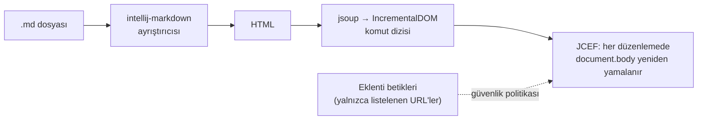
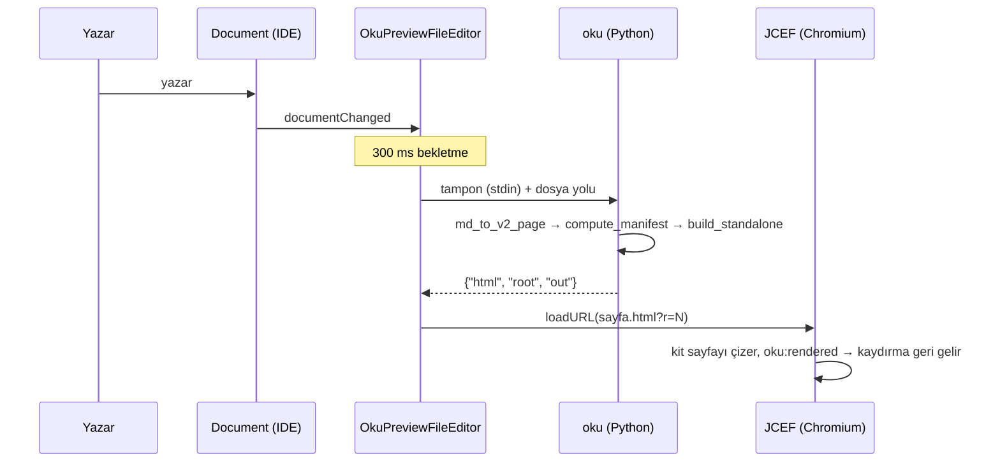
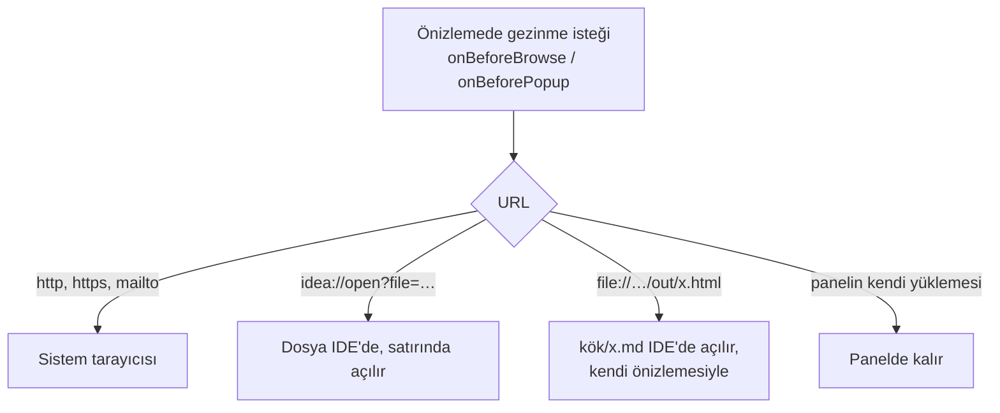

> [!TLDR]
> Doğru yol IDEA'nın Markdown önizlemesine eklenti yazmak değil, **oku sayfaları için kendi düzenleyicimizi açmak**: solda IDE'nin metin düzenleyicisi, sağda gömülü Chromium'da kitin kendi çalışma zamanı. PoC bunu IDEA 2026.2.3 üzerinde çalıştırdı.
>
> - Önizleme `oku build`'in ürettiği sayfanın aynısı: aynı dönüştürücü, aynı `build_standalone`, aynı chrome.js. IDE içinde sayılan bölüm, diyagram, kod satırı ve içindekiler bağlantısı, başsız Chromium'dakilerle birebir aynı çıktı.
> - Diskteki bir değişiklik, IDE'nin eşitlemesi dahil 1,00–1,05 saniyede önizlemeye düşüyor ve okuma konumu korunuyor. Sayfa bağlantısı ile "editörde aç" bağlantısı dosyayı IDE'de açıyor.
> - Sırada: PoC'nin oku'nun iç fonksiyonlarına bağlı köprüsünü bir `oku preview` komutuna çevirmek, sayfayı yeniden yüklemeden güncellemek, düzenleyiciyle önizlemenin kaydırmasını eşlemek, tipli bloklara şema destekli tamamlama eklemek.

Bu belge bir **öğretici** sırayla ilerliyor: her bölüm bir önceki sorunun bıraktığı soruyu cevaplıyor. Önce IDEA'nın bugün ne yaptığı, sonra iki çözüm yolu ve neden birinin seçildiği, sonra PoC'nin gösterdikleri ve en sonda plan ile senin vermen gereken kararlar.

## IDEA bir oku sayfasını bugün nasıl gösteriyor? {#bugun}

IDEA'nın gömülü Markdown eklentisi bir `.md` dosyasını kendi ayrıştırıcısıyla (intellij-markdown) HTML'e çeviriyor, sonra bu HTML'i her düzenlemede gömülü Chromium'daki (JCEF) sayfanın `<body>`'sine yamayarak gösteriyor. oku'nun ayrıştırıcısı, tipli blokları ve sayfa çerçevesi bu hattın hiçbir yerinde yok. Bu yüzden sayfa "dümdüz Markdown" gibi görünüyor.



*Gömülü önizlemenin hattı. Kaynak: [MarkdownJCEFHtmlPanel.kt](https://github.com/JetBrains/intellij-community/blob/cf6ba6dbed8ca02ca1bdd5abfe22c45b3f885519/plugins/markdown/jcef/src/com/intellij/markdown/jcef/preview/MarkdownJCEFHtmlPanel.kt) satır 262: `IncrementalDOM.patch(document.body, …)`.*

Bir oku sayfasının parçaları bu hattan şöyle geçiyor:

```oku-table
{"headers":["oku öğesi","Gömülü önizlemede","Kanıt"],"rows":[["YAML front-matter","Gizli (2026.2); bir kayıt anahtarıyla ham `<pre>`. 2026.3 dalında tablo olarak çiziliyor","kaynakta okundu"],["` ```oku-chart ` ve diğer tipli bloklar","Bilinmeyen dilde düz kod bloğu","kaynaktan çıkarım"],["`> [!TLDR]`","Düz alıntı bloğu: 2026.2 yalnızca NOTE, TIP, IMPORTANT, WARNING, CAUTION tanıyor","kaynakta okundu"],["`mermaid`","JetBrains'in Mermaid eklentisi kuruluysa çiziliyor","eklenti jar'ında okundu"],["İçindekiler, ilerleme rayı, menü, arama, sözlük ipuçları","Yok","—"],["`#f/` dosya çipleri, `#g/` sözlük bağlantıları","Sayfa içi ölü bağlantı","kaynaktan çıkarım"]]}
```

O zaman ilk soru şu: oku bu hattın içine takılabilir mi?

## Neden "mevcut önizlemeye eklenti" yolu tıkanıyor? {#yol-a}

İlk akla gelen yol, oku'yu gömülü önizlemeye bir eklenti olarak takmak. Markdown eklentisinin bunun için uzantı noktaları var: tarayıcıya betik ve stil enjekte eden `browserPreviewExtensionProvider`, belirli bir dildeki kod bloğunu HTML'e çeviren `fenceGeneratingProvider` ve ayrıştırmayı değiştiren `flavourProvider`. JetBrains'in Mermaid eklentisi tam da bu yolu kullanıyor. Ancak oku'nun ihtiyacına üç yerden takılıyor:

```oku-compare-grid
{"cards":[{"t":"A · Gömülü önizlemeye eklenti","b":"Tipli blokları `fenceGeneratingProvider` ile çizip kitin betiklerini `browserPreviewExtensionProvider` ile enjekte etmek.\n\n- IDE her düzenlemede `document.body`'yi yeniden yamalıyor; kitin eklediği kenar çubuğu, ray ve kendi içeriğini çizen her öğe bir sonraki yamada siliniyor *(incremental-dom davranışından çıkarım, denenmedi)*.\n- Güvenlik politikası satır içi betiğe ve `fetch`'e kapalı (`connect-src 'none'`); kit `kit.json`'u, sözlüğü ve manifesti okuyamıyor.\n- Blok uzantı noktası `@Internal` ve `@Obsolete`; çıktısı `<pre><code>` içine sarılıyor.","verdict":"bad"},{"t":"B · Kendi düzenleyicimiz","b":"oku sayfaları için ayrı bir düzenleyici: solda platformun metin düzenleyicisi, sağda bizim yönettiğimiz bir JCEF tarayıcısı. İçinde kitin kendisi çalışıyor.\n\n- Çizim `oku build` ile aynı, çünkü aynı kod çalışıyor.\n- Güvenlik politikası ve güncelleme modeli bizim.\n- Kullanılan API'ler herkese açık: `FileEditorProvider`, `TextEditorWithPreview`, `JBCefBrowser`.\n- Bedeli: dönüştürücü Python'da, makinede oku kurulu olmalı.","verdict":"good"},{"t":"C · B + A'nın küçük bir parçası","b":"oku ağacındaki sayfalar B ile açılır. oku ağacı dışındaki sıradan bir `.md` dosyası yalnızca bir `oku-chart` içeriyorsa, o blok gömülü önizlemede A'nın blok uzantısıyla çizilir.\n\nSonraya bırakılabilecek bir ek: çekirdek ihtiyaç B ile karşılanıyor, A'nın kırılgan API'si yalnızca bu dar durum için devreye girer.","verdict":"neutral"}]}
```

Karşılaştırmanın hangi eksende yapıldığı sonucu değiştiriyor. Bu yüzden eksenler ayrı ayrı:

```oku-table
{"headers":["Eksen","A · Gömülü önizlemeye eklenti","B · Kendi düzenleyicimiz"],"rows":[["Çizimin `oku build` ile aynı olması","Kısmi: ayrıştırıcı intellij-markdown, kitin çerçevesi yok","Aynı: PoC'de IDE içi sayılar başsız Chromium'la birebir"],["Canlı güncelleme","IDE body'yi yamalıyor; kit DOM'u kalıcı değil *(çıkarım)*","Bizim elimizde: bugün yeniden yükleme, sonra yerinde güncelleme"],["Güvenlik politikası","Satır içi betik yok, `fetch` yok","Kendi politikamız"],["API kararlılığı","Blok uzantısı `@Internal`, `@Obsolete`","Herkese açık platform API'leri"],["Kurulum bağımlılığı","Yalnızca eklenti (kit JS'i içine paketlenir)","Makinede kurulu oku (Python) — **B'nin zayıf ekseni**"],["Gömülü önizleme","Aynı panel","oku sayfalarında gizlenir, diğer `.md` dosyaları etkilenmez"]]}
```

**Kurulum bağımlılığı ekseninde sıralama tersine dönüyor.** oku kurulu olmayan biri için A, ya da dönüştürücüsü JavaScript'e taşınmış bir B tek seçenek. Senin makinende oku kurulu ve eklentiyi önce sen kullanacaksın; bu yüzden aşağıdaki öneri B. Eklenti başkalarına dağıtılacaksa bu karar yeniden açılmalı ([kararlar](#kararlar)).

Kaynaklar, hepsi intellij-community `cf6ba6d` (2026-10-06) üzerinde okundu: [Markdown eklentisinin plugin.xml'i](https://github.com/JetBrains/intellij-community/blob/cf6ba6dbed8ca02ca1bdd5abfe22c45b3f885519/plugins/markdown/core/resources/META-INF/plugin.xml), [PreviewStaticServer.kt](https://github.com/JetBrains/intellij-community/blob/cf6ba6dbed8ca02ca1bdd5abfe22c45b3f885519/plugins/markdown/core/src/org/intellij/plugins/markdown/ui/preview/PreviewStaticServer.kt) (`createCSP`, satır 93-97), [CodeFenceGeneratingProvider.kt](https://github.com/JetBrains/intellij-community/blob/cf6ba6dbed8ca02ca1bdd5abfe22c45b3f885519/plugins/markdown/core/src/org/intellij/plugins/markdown/extensions/CodeFenceGeneratingProvider.kt), [MarkdownAlertTitle.kt](https://github.com/JetBrains/intellij-community/blob/cf6ba6dbed8ca02ca1bdd5abfe22c45b3f885519/plugins/markdown/core/src/org/intellij/plugins/markdown/lang/psi/impl/MarkdownAlertTitle.kt). Mermaid eklentisinin kaynağı kapalı; davranışı eklenti jar'ındaki `mermaid-withMarkdown.xml`'den okundu.

## Önerilen yol nasıl çalışıyor? {#mimari}

Eklenti bir oku sayfasını açtığında IDE'nin kendi metin düzenleyicisini ve bir önizleme panelini yan yana koyuyor. Panel, sayfayı kendi çizmiyor: düzenleyicideki metni (kaydedilmemiş olsa bile) kurulu oku aracına veriyor, oku `oku build`'in tek bir sayfa için yaptığı işi yapıyor ve panel çıkan sayfayı gösteriyor.



*Bir düzenlemenin yolculuğu. HTML, projede değil IDE'nin sistem dizininde (`system/oku-preview/`) duruyor; Chromium'a taşıma aracı, kullanıcının gördüğü ya da işlediği bir dosya değil.*

Panelden çıkmak isteyen her gezinme isteği yakalanıyor ve IDE'ye devrediliyor. Böylece önizleme hiçbir zaman başka bir sayfaya "kaymıyor":



PoC'nin parçaları aşağıda. Bu düzenek gerçekten build'in çizimini veriyor mu, ve ne kadar hızlı? Sonraki bölüm ölçümleri gösteriyor.

```oku-table
{"headers":["Dosya","Ne yapıyor"],"rows":[["[OkuPreviewEditorProvider.kt](#f/ide/intellij/src/main/kotlin/io/github/mmdemirbas/oku/OkuPreviewEditorProvider.kt)","Hangi dosyaları alacağına karar verir ve metin + önizleme düzenleyicisini kurar. `HIDE_OTHER_EDITORS` yalnızca kabul edilen dosyada Markdown'ın kendi önizlemesini gizler."],["[OkuPages.kt](#f/ide/intellij/src/main/kotlin/io/github/mmdemirbas/oku/OkuPages.kt)","Bir `.md` dosyası oku sayfası mı: üst dizinlerde `kit.json` ya da `_oku` (`.git`'e kadar) varsa veya dosyada ` ```oku- ` bloğu geçiyorsa. Front-matter tek başına işaret değil; Jekyll ve Hugo sayfalarında da var."],["[OkuPreviewFileEditor.kt](#f/ide/intellij/src/main/kotlin/io/github/mmdemirbas/oku/OkuPreviewFileEditor.kt)","JCEF paneli, 300 ms bekletmeli yeniden çizim, IDE temasına uyum ve bağlantıların IDE'ye devri."],["[OkuTool.kt](#f/ide/intellij/src/main/kotlin/io/github/mmdemirbas/oku/OkuTool.kt)","Kurulu oku'nun Python'unu `oku` başlatıcısının shebang satırından bulur ve köprüyü çalıştırır. Dock'tan açılan IDE'de kabuğun PATH'i olmadığı için `~/.local/bin` de aranır."],["[preview.py](#f/ide/intellij/src/main/resources/oku-preview/preview.py)","Köprü: tamponu `md_to_v2_page` ile sayfaya çevirir, ağacın manifestini hesaplar, `build_standalone` ile tek sayfayı yazar. Tema ve kaydırma için küçük bir sayfa içi betik ekler."],["[plugin.xml](#f/ide/intellij/src/main/resources/META-INF/plugin.xml)","`com.intellij.modules.platform` ve `com.intellij.modules.jcef` bağımlılıkları, tek uzantı: `fileEditorProvider`."]]}
```

## PoC ne gösterdi? {#poc}

### IDE içindeki çizim, build'in çizimiyle aynı mı?

Aynı. IDE'nin gömülü Chromium'u uzaktan hata ayıklama portuyla (9222) açıldı ve sayfa, repodaki tarayıcı testlerinin yaptığı gibi CDP üzerinden sayıldı. Aynı sayfanın başsız Chromium'daki sayılarıyla karşılaştırma:

```oku-table
{"headers":["docs/index.md","Başsız Chromium","IDE içi (JCEF, 428 × 885)"],"rows":[["Bölüm","4","4"],["Mermaid diyagramı (SVG)","1 (5)","1 (5)"],["Kod satırı","28","28"],["İçindekiler bağlantısı","6","6"],["Site ağacı satırı","16","16"],["Tema","koyu (istenen)","koyu (IDE koyu temada)"],["Konsol hatası / başarısız istek","0 / 0","ölçülmedi"]]}
```

Başsız Chromium'da daha ağır iki sayfa da tarandı: `reference.md` 41 tablo, 268 kod satırı, 5 dosya çipi; `charts.md` 92 grafik. Hiçbirinde konsol hatası ya da başarısız istek yok. Mermaid ve Prism, ağ olmadan kitin kendi kopyasından yüklendi.


*IDE içindeki önizleme, CDP ekran görüntüsü. Panel bölünmüş düzenleyicinin yarısı olduğu için kit telefon düzenine geçmiş.*

### Bir düzenleme ne kadar sürede görünüyor?

Her düzenlemede kurulu oku bir süreç olarak çalışıyor. Bir çalıştırma sayfaya göre 0,20–0,33 saniye sürüyor ve bunun yaklaşık 90 ms'si yalnızca Python'un başlaması. Sayılar [measure_render.py](#f/ide/intellij/tools/measure_render.py) ile üretildi; grafiğin verisi onun çıktısı:

```oku-chart
{"type":"stacked-bar","title":"Bir yeniden çizimin dönüştürme maliyeti, ms (sıcak, 5 koşunun ortancası)","categories":["index.md (7 KB)","charts.md (75 KB)","reference.md (49 KB)"],"series":[{"label":"Python başlangıcı + içe aktarma","values":[92,89,92]},{"label":"md → sayfa sözlüğü","values":[36,38,41]},{"label":"site manifesti","values":[53,56,53]},{"label":"standalone HTML","values":[20,26,143]}]}
```

*Python'un başlaması her sayfada aynı, yaklaşık 90 ms; reference.md'nin standalone adımı ise 143 ms, çünkü sayfanın `#f/` ile andığı dosyaların baytları sayfanın içine taşınıyor (çıktı 3,4 MB). Manifest her çizimde bütün ağaç için yeniden hesaplanıyor; 73 sayfalık bir ağaçta bu maliyet ölçülmedi.*

Uçtan uca süre IDE içinde ölçüldü. Bir sayfa diske yazıldı ve IDE'nin penceresi etkinleştirildi, çünkü IDE dışarıdan gelen değişikliği ancak pencere etkinleşince ya da yeni bir sekme açılınca okuyor. Bu süre IDE'nin eşitlemesini, 300 ms bekletmeyi, dönüştürmeyi ve sayfanın yeniden yüklenmesini içeriyor: üç koşuda **1,00–1,05 saniye**, geri almada 0,98–1,01 saniye. Klavyeden yazmada eşitleme adımı yok, metin doğrudan Document'a giriyor. O yolun süresi ayrıca ölçülmedi.

### Neler denendi, neler denenmedi?

```oku-table
{"headers":["Davranış","Sonuç","Nasıl"],"rows":[["Sayfa IDE'de kitin çizimiyle açılır","index: tablodaki sayılar · architecture: 12 bölüm, 6 diyagram (30 SVG), 38 kod satırı","[probe_ide.py](#f/ide/intellij/tools/probe_ide.py)"],["Ön sekmedeki değişiklik önizlemeye düşer","1,00–1,05 sn, 3 koşu","[edit_sync_ide.py](#f/ide/intellij/tools/edit_sync_ide.py)"],["Arka sekmedeki önizleme de güncellenir","ön sekmeyle aynı anda","edit_sync_ide.py, iki dosyayla"],["Okuma konumu korunur","600 px → 598,5–600 px","[nav_and_edit_ide.py](#f/ide/intellij/tools/nav_and_edit_ide.py)"],["Sayfa bağlantısı IDE'de açılır, panel yerinde kalır","IDE günlüğü: `fileOpened reference.md`","nav_and_edit_ide.py"],["`idea://` \"editörde aç\" bağlantısı","IDE günlüğü: `fileOpened glossary.md`, panel yerinde","[idea_link_ide.py](#f/ide/intellij/tools/idea_link_ide.py)"],["Tema IDE'yi izler","koyu IDE → `data-theme=dark`","probe_ide.py"],["Yeniden yükleme sonrası kaydırma","2400 → 2400 px, 120 ms içinde","[check_preview.py](#f/ide/intellij/tools/check_preview.py)"]]}
```

Denenmeyenler, ve neden:

- **Klavyeden yazarken gecikme.** Kod yolu aynı (`documentChanged`), ama süre disk değişikliği ve pencere etkinleştirmesiyle ölçüldü.
- **Dış bağlantının sistem tarayıcısında açılması.** Senin tarayıcında bir sekme açacağı için tetiklenmedi.
- **`idea://` ile açılan dosyada imlecin 20. satırda olması.** Dosyanın açıldığı görüldü, imlecin satırı okunmadı.
- **IDE teması çalışırken değişince önizlemenin uyması.** Kod `LafManagerListener` ile yeniden çiziyor, tetiklenmedi.
- **Windows, Linux ve diğer IntelliJ tabanlı IDE'ler.** Eklenti yalnızca platforma ve JCEF'e bağlı; çalışması beklenir, denenmedi.
- **Metin tarafında Markdown özellikleri** (vurgulama, yapı görünümü). Sol taraf platformun Markdown dosya türündeki normal düzenleyicisi, `HIDE_OTHER_EDITORS` yalnızca Markdown'ın bölünmüş düzenleyicisini gizliyor. Özelliklerin sürmesi beklenir, ekran görüntüsüyle doğrulanmadı.

Bu sonuçlara giden yolda düzeltilmesi gereken yedi şey çıktı.

## PoC yolda neye takıldı? {#tuzaklar}

Her birinin sonraki aşamalara taşınacak bir dersi var. İlk dördü eklentide düzeltildi; son üçü test düzeneğini etkiledi.

```oku-timeline
{"events":[{"status":"done","label":"derleme","t":"IDEA 2026.2, Kotlin 2.4 ile derlenmiş","b":"Platformun Kotlin standart kütüphanesi 2.4.0 metadata'sı taşıyor; Kotlin 2.2 derleyicisi en fazla 2.3'ü okuyabildiği için `Regex` bile çözülemedi. Eklenti Kotlin 2.4.20 ile derleniyor."},{"status":"done","label":"derleme","t":"JCEF artık ayrı bir gömülü eklenti","b":"`com.intellij.ui.jcef` platform çekirdeğinde değil, `com.intellij.modules.jcef` eklentisinde. Gradle'da `bundledPlugin`, plugin.xml'de `depends` gerekiyor."},{"status":"done","label":"kaydırma","t":"Kit `<html>` üzerinde `scroll-behavior: smooth` kullanıyor","b":"Yeniden yüklemeden sonra düz bir `scrollTo`, sayfayı her düzenlemede tepeden aşağı kaydırarak canlandırıyordu (300 ms'de 2400 yerine 1938 px). Geri yükleme artık `behavior: 'instant'`."},{"status":"done","label":"güncelleme","t":"JBCef aynı URL'yi ikinci kez yüklemiyor","b":"`JBCefBrowserBase.loadUrlImpl` en son istenen URL'yi atlıyor: \"URL already requested, skipping\" ([kaynak](https://github.com/JetBrains/intellij-community/blob/cf6ba6dbed8ca02ca1bdd5abfe22c45b3f885519/platform/ui.jcef/jcef/JBCefBrowserBase.java#L668-L683)). İlk sürümde her yeniden çizim yapılıyor ama panele hiç ulaşmıyordu. Her çizime bir `?r=N` sorgusu ekleniyor ([OkuPreviewFileEditor.kt](#f/ide/intellij/src/main/kotlin/io/github/mmdemirbas/oku/OkuPreviewFileEditor.kt), `render()`)."},{"status":"note","label":"test","t":"IDE dış değişikliği etkinleşince okuyor","b":"Arka plandaki IDE diske yazılan değişikliği görmüyor. Test, pencereyi önce başka bir uygulamaya, sonra IDE'ye vererek eşitlemeyi tetikliyor. Yazan bir kullanıcı bu yoldan geçmiyor."},{"status":"note","label":"test","t":"Yeni sekmenin tarayıcısı ancak boyanınca doğuyor","b":"Arka plandaki pencerede açılan bir sekmenin JCEF tarayıcısı CDP'de geç görünüyor. Dosyanın açıldığına bu yüzden IDE günlüğünden (`fileOpened`) bakıldı."},{"status":"note","label":"test","t":"Kit okurken URL'nin hash'ini yazıyor","b":"Kaydırma izleyicisi adresi `index.html#tldr` yapıyor. Testler sayfayı adın sorgu ve hash'ten arındırılmış haliyle buluyor."}]}
```

## Bundan sonra ne yapılmalı? {#plan}

Bu tuzaklar PoC'yi çalışır hale getirdi; ürüne giden yol ise aşağıdaki aşamalardan geçiyor. Her aşama tek başına kullanılabilir bir sonuç bırakıyor. İlk üçü oku reposunda bir **sözleşme** kuruyor; eklenti şimdiye kadar bunun yerine oku'nun iç fonksiyonlarına ve URL sözdizimine dayanıyordu.

```oku-step-flow
{"steps":[{"t":"Kit sözleşmesi: `oku preview` komutu","b":"[preview.py](#f/ide/intellij/src/main/resources/oku-preview/preview.py)'yi bir CLI alt komutuna çevirmek: `--path`, tampon stdin'den, tek satır JSON çıktı. Ardından kalıcı bir süreç modu: istekler stdin'den satır satır gelir. Böylece her düzenlemede yaklaşık 90 ms'lik Python başlangıcı kalkar ve manifest önbellekte tutulur. Kitin sürüm damgasıyla bir el sıkışması, eski bir oku kuruluysa açık bir hata versin.","meta":"oku repo · cli.py + testler + cli.md tablosu"},{"t":"Yeniden yüklemeden güncelleme","b":"Kitte belgelenmiş bir gömme API'si (ör. `OkuRenderer.renderPage(page)`): `oku:rendered`'ı ateşlesin, açık ayrıntıları ve kaydırmayı **bölüm kimliğine** bağlayarak korusun. Eklenti sayfa JSON'unu `executeJavaScript` ile iter; 1,4–3,4 MB'lık sayfa her düzenlemede yeniden yüklenmez. Bugünkü `renderMarkdownInto` bu işi görmüyor: `oku:rendered` ateşlemiyor, bu yüzden kitin bu olayı bekleyen parçaları (içindekiler, yerelleştirme, ayarlar) başlamıyor. ajans projesinin gömme modülü (`oku.ts`, 689 satır) bu eksikleri elle kapatıyor.","meta":"oku repo (renderer.js) + eklenti"},{"t":"Ana makine kancası","b":"`window.__okuHost = { openFile(yol, satır), openPage(yol) }`: kit dosya çipinde, `.md` bağlantısında ve editör satırında önce buna sorsun. Eklenti bunu `JBCefJSQuery` ile bağlar. Bugünkü `idea://` köprüsü kitte yalnızca macOS'ta sunuluyor; kanca bu kısıtı kaldırır.","meta":"oku repo (chrome.js) + eklenti"},{"t":"Düzenleyici ile önizlemeyi eşleme","b":"`md_to_v2_page` bir `block_lines` haritası (blok sırası → kaynak satırı) zaten üretebiliyor. İmleç hareket edince önizleme ilgili bloğa kayar, önizlemede bir bloğa tıklanınca düzenleyici o satıra gider.","meta":"eklenti + küçük kit desteği"},{"t":"Yazarlık desteği","b":"` ```oku-* ` bloklarının içine JSON dil enjeksiyonu ve `page.schema.json`'daki `$defs` ile tamamlama ve doğrulama. `oku check --json` çıktısı bir `ExternalAnnotator` ile satır içi uyarı olarak gösterilir. `#f/` yolları için dosya tamamlama.","meta":"eklenti"},{"t":"Sağlamlaştırma ve dağıtım","b":"oku bulunamazsa Markdown önizlemesine geri düşme ve bildirim. oku yolu için bir ayar sayfası. İçerik okuyan `accept()` yerine `AsyncFileEditorProvider`, `@Obsolete` olan `Alarm` yerine coroutine tabanlı bekletme. Platform testleri ve CDP ile önizleme testleri CI'da, `verifyPlugin`, imzalama, dağıtım kanalı.","meta":"eklenti"}]}
```

Bu aşamaların bir kısmı, önce verilmesi gereken kararlara bağlı.

## Hangi kararlar sende? {#kararlar}

```oku-table
{"headers":["Karar","Seçenekler","Öneri","Neye dayanarak"],"rows":[["Eklenti nerede yaşasın","oku reposu (`ide/intellij/`, PoC burada) · ayrı bir repo","oku reposu","Eklentinin sözleşmesi (CLI komutu, JS API'si, ana makine kancası) kitle birlikte değişiyor; iki tarafın testleri aynı yerde birbirini tutar."],["Kime dağıtılacak","Yalnızca senin makinen (yerel zip) · JetBrains Marketplace","Önce yerel zip","Python bağımlılığının kabul edilebilir olup olmadığını bu karar belirliyor. Marketplace kararı aşağıdaki dönüştürücü kararını yeniden açar."],["Dönüştürücü nerede çalışsın","Python (kurulu oku) · JavaScript'e taşınmış bir kopya","Python","Tek kaynak. Bu repo, aynı kuralın iki kopyasının sessizce ayrıştığı hatalarla dolu: başlık kimliği kuralı üç yerde, blok türü listesi yedi yerde, sürüm sabiti iki yerde ayrıştı."],["Hangi dosyalar oku sayılsın","Sezgisel (`kit.json`, `_oku`, ` ```oku- ` bloğu) · proje başına açık katılım","Sezgisel + kapatma ayarı","Açık katılım ilk kullanımda hiçbir şey göstermez. Sezgisel kural bu repodaki `docs/` sayfalarını doğru tanıdı; README gibi dosyalarda denenmedi."],["Güncelleme modeli","Yeniden yükleme (bugün) · yerinde çizim","Yerinde çizim (plan 2. aşama)","Yeniden yükleme açık bir ayrıntıyı, ışık kutusunu ve görüntüleyiciyi kapatıyor, büyük sayfada her düzenlemede MB'larca HTML okutuyor."]]}
```

## Nasıl denenir? {#dene}

PoC'yi kendi IDEA'na kurmak için IntelliJ IDEA 2026.2 veya üstü ve kurulu oku (`./ctl deploy`) gerekiyor:

```bash
cd ide/intellij
JAVA_HOME=$(/usr/libexec/java_home -v 21) ./gradlew buildPlugin
# build/distributions/oku-intellij-0.0.1-poc.zip
# Settings → Plugins → ⚙ → Install Plugin from Disk…
```

Ardından bu repodaki [`docs/index.md`](#f/docs/index.md) dosyasını aç: sağda kitin çizdiği sayfa görünür. Kum havuzunda (sandbox) denemek ve ölçümleri tekrarlamak için `./gradlew runIde` ile `tools/` altındaki betikler yeterli; ayrıntılar [README.md](#f/ide/intellij/README.md) dosyasında.

## Sık sorulanlar {#sss}

```oku-table
{"headers":["Soru","Cevap","Dayanak"],"rows":[["“HTML üretmek zorunda kalmayalım” demiştin; PoC yine HTML üretiyor mu?","Evet, ama projede değil: IDE'nin sistem dizininde (`system/oku-preview/<ağaç>/`). Kullanıcının açtığı, işlediği ya da `oku build` çalıştırması gereken bir dosya değil, yalnızca Chromium'a taşıma aracı. Plandaki 2. aşamadan sonra her düzenlemede yazılan şey yalnızca sayfa JSON'u olur.","PoC'de görüldü"],["oku kurulu değilse ne oluyor?","PoC panelde hata sayfası gösteriyor: oku'yu nerede aradığını ve oku'nun ne dediğini. Planın son aşamasında eklenti geri çekiliyor ve dosya IDE'nin kendi Markdown önizlemesiyle açılıyor.","kodda; tetiklenmedi"],["Gömülü Markdown önizlemesini kaybediyor muyum?","Yalnızca oku sayfalarında. `HIDE_OTHER_EDITORS` dosya başına uygulanıyor: eklentinin kabul ettiği dosyada Markdown'ın bölünmüş düzenleyicisi gizleniyor, README gibi diğer `.md` dosyaları eskisi gibi açılıyor.","[kaynakta okundu](https://github.com/JetBrains/intellij-community/blob/cf6ba6dbed8ca02ca1bdd5abfe22c45b3f885519/platform/platform-impl/src/com/intellij/openapi/fileEditor/impl/FileEditorProviderManagerImpl.kt#L198-L207)"],["Bölünmüş düzenleyicinin düzen düğmeleri (yalnız metin, yalnız önizleme) çalışıyor mu?","Çalışması beklenir: düğmeler platformun `TextEditorWithPreview` sınıfından geliyor ve eklenti bu sınıfı doğrudan kullanıyor. Onu saran `TextEditorWithPreviewProvider` ise 2026.2'de iç API'ye çekildi; eklenti onu kullanmıyor.","beklenti; ekranda doğrulanmadı"],["PyCharm, GoLand gibi diğer IDE'lerde çalışır mı?","Eklenti yalnızca `com.intellij.modules.platform` ve `com.intellij.modules.jcef`'e bağlı, bu yüzden 2026.2 tabanlı her IntelliJ IDE'sinde çalışması beklenir.","yalnızca IDEA 2026.2.3'te denendi"],["Büyük bir ağaçta yavaşlamaz mı?","Bugün her çizim bütün ağacın manifestini yeniden hesaplıyor; bu repodaki `docs/` ağacında 53–56 ms. Planın 1. aşamasındaki kalıcı süreç manifesti önbellekte tutar.","docs/ ölçüldü; 73 sayfalık ağaç ölçülmedi"]]}
```
